# MIQ: Medical Image Quick Look

MIQ is a lightweight **macOS Quick Look extension** for medical volume images. Press **Space** on a supported file in Finder to get an **interactive orthogonal slice view** next to a metadata panel. A Windows counterpart, [**MIQ-Win**](https://github.com/marcoduering/MIQ-Win), is also available.

<div align="center">
  <picture>
    <source media="(prefers-color-scheme: dark)" srcset="https://raw.githubusercontent.com/marcoduering/MIQ/main/docs/MIQ_Bento_dark.webp">
    
  </picture>
</div>

<div align="center">
  <picture>
    <source media="(prefers-color-scheme: dark)" srcset="docs/lottie/quicklook_dark.svg">
    
  </picture>
  <picture>
    <source media="(prefers-color-scheme: dark)" srcset="docs/lottie/crosshair_dark.svg">
    
  </picture>
</div>

**See it in action** in the short video at the bottom of this page.

## Features

MIQ is a convenience tool for looking inside files quickly. It prioritizes speed and ease of use over advanced visualization and does not replace a dedicated viewer.

**Preview**
- 2×2 coronal / sagittal / axial view with a linked crosshair, the voxel value under it and, for FreeSurfer-style label maps, the label name
- 4D series: step through volumes; per-volume or shared intensity window
- Zoom, pan and maximize a single panel; drag to adjust brightness and contrast
- Colormaps (grayscale, hot, viridis, inferno; diverging for signed statistical maps) and segmentation colors, with the FreeSurfer LUT for aseg/aparc
- Fourth panel switches between metadata, maximum- and minimum-intensity projections (MIP/MinIP) and a 3D rendering, computed only when you ask for them
- CT window presets (brain, subdural, stroke, bone, lung, soft tissue); CT detection is a guess from the stored values and off by default
- Overlays: masks, segmentations and statistical maps from the same folder, offered but never applied automatically
- Direction-encoded color for diffusion vector images
- Copy the current view as an image (⌘C)
- Finder thumbnails (optional, off by default)

**Metadata and checks**
- Format, dimensions, spacing, orientation, datatype, volumes and scaling, plus TR, intent, diffusion shells, crosshair position and BIDS sidecar values when present. The order and visibility of rows are configurable.
- Orientation diagnostics: the orientation code, obliquity and transform source, with a warning when qform and sform disagree or there is no transform
- Data QC rows: likely sequence, head-mask coverage, a defacing check and data sanity checks; for 4D time series, median temporal SNR and spike volumes. They are hints computed from the image alone, not an assessment.
- By default the display shows data **as stored on disk**, without reorienting, so you see the raw orientation. Neurological or radiological view can be switched on in the app.

**In the MIQ app**
- Settings with live examples, and a **Controls** pane listing every gesture
- **Open With → MIQ** opens a file in a viewer window with the same preview
- **Tools → Brain Mask…** runs a bundled [brainchop](https://github.com/neuroneural/brainchop) MeshNet model (MIT) on your Mac and saves a BIDS-style `*_desc-brain_mask.nii.gz`. A data-preparation helper; check the mask before using it.
- **Describe file** (opt-in, off by default): a short technical description of a file from Apple's on-device model (macOS 26 or later) or a local OpenAI-compatible server on `localhost`
- Interface in English, German and Turkish

**Integration**
- `miq` command-line tool (see [below](#command-line-tool-miq))
- **Shortcuts / App Intents**: *Get Volume Info* and *Render Center Slice*
- **Spotlight importer**: indexes dimensions, spacing, datatype, volumes and orientation from the header, so `mdfind 'org_miq_volumes > 1'` finds 4D files. See [docs/SPOTLIGHT.md](./docs/SPOTLIGHT.md).
- Managed settings (MDM) for organizations; see [For IT administrators](#for-it-administrators)

The App Intents and the Spotlight importer are new and have had less testing on real Macs than the preview. Please [report](https://github.com/marcoduering/MIQ/issues) anything that doesn't work.

## Supported formats

<div align="center">
  <picture>
    <source media="(prefers-color-scheme: dark)" srcset="docs/lottie/formats_dark.svg">
    
  </picture>
</div>

| Format | Extensions | Notes |
|---|---|---|
| NIfTI-1 and NIfTI-2 | `.nii`, `.nii.gz` | |
| FreeSurfer MGH | `.mgh`, `.mgz`, `.mgh.gz` | |
| MRtrix | `.mif`, `.mif.gz`, `.mih` | `.mih`: detached header + data file |
| NRRD | `.nrrd`, `.nhdr` | `.nhdr`: single data file, `LIST`, or printf-style `slice%03d.raw` |
| MetaImage (ITK) | `.mha`, `.mhd` | `.mhd`: detached `.raw` / `.zraw`; zlib `CompressedData` |
| DICOM | `.dcm`, `.dicom` | One Part-10 file, single- or multi-frame; uncompressed little-endian only. Compressed transfer syntaxes (JPEG, JPEG 2000, RLE) are not supported yet. Extensionless DICOM files are not recognized. |
| OME-Zarr, NIfTI-Zarr, Zarr v2/v3 | `.zarr`, `.ome.zarr`, `.nii.zarr` | Shows the lowest-resolution pyramid level; first time point and channel |

MIQ picks the parser by file extension, so files need the right one. Detached headers (`.nhdr`, `.mih`, `.mhd`) only read data files in the header's own folder or a subfolder; a data file referenced by an absolute path elsewhere, via `..`, or through a symlink leading out of that folder is refused.

## Installation & Updates

The app and extension can be installed manually or via the package manager [Homebrew](https://brew.sh).

> The app is a universal binary for Apple Silicon (arm64) and Intel (x86_64) Macs and has been tested on macOS 14 (Sonoma), 15 (Sequoia), 26 (Tahoe) and 27 (Golden Gate).

### Manual installation

1. 👉 **[Download the latest release (MIQ.app.zip)](https://github.com/marcoduering/MIQ/releases/latest/download/MIQ.app.zip)**
[](https://github.com/marcoduering/MIQ/releases/latest/download/MIQ.app.zip)
2. Unzip and move **`MIQ.app`** to your **`/Applications`** folder.
3. **Open `MIQ.app`** at least once to register the Quick Look extension.
4. Press **Space** on any supported file in Finder.
5. Optional: **Customize the preview** in the MIQ app.

#### Updating

MIQ updates itself. Open the MIQ app and choose MIQ → Check for Updates…, or leave **Check for updates automatically** enabled in the app's **General** pane (on by default).

Automatic checks and updates happen when you open the main app, so make sure to do this from time to time.

### Installation via Homebrew

1. Install on the command line:

   ```bash
   brew tap marcoduering/miq
   brew trust --cask marcoduering/miq/miq
   brew install --cask miq
   ```

2. **Open `MIQ.app`** (in `/Applications`) at least once to register the Quick Look extension.
3. Press **Space** on any supported file in Finder.
4. Optional: **Customize the preview** in the MIQ app.

#### Updating via Homebrew

The cask is marked `auto_updates`, so the app updates itself (see above). To update through Homebrew instead:

```bash
brew update
brew upgrade --cask miq --greedy
```

## Usage

### Controls

Click a slice first so the preview has keyboard focus. The app's **Controls** pane shows the same list, for mouse or trackpad.

| Action | Mouse | Trackpad |
|---|---|---|
| Move the crosshair | Click or drag | Click, tap or one-finger drag |
| Scroll through slices | Scroll wheel | Two-finger scroll |
| Change volume (4D) | ⌥ + scroll wheel | ⌥ + two-finger scroll |
| Brightness / contrast | Secondary-click + drag (up/down: level, left/right: width) | same |
| Zoom | ⌘ + scroll wheel, around the pointer | Pinch (or ⌘ + scroll) |
| Pan when zoomed | ⇧-drag, Space-drag or middle-drag | Two-finger scroll or ⇧-drag |
| Maximize a panel / restore | Double-click | Double-click |
| Presets, colormaps, overlays, Copy Image | Secondary-click (or ⌃-click) | same |
| Rotate / zoom the 3D view | Drag / scroll | Drag / pinch |

| Key | Action |
|---|---|
| `1`–`6` | CT window presets: Brain, Subdural, Stroke, Bone, Lung, Soft Tissue |
| `A` | Automatic window |
| `C` | Next colormap |
| `P` | Fourth panel: Metadata → MIP → MinIP → 3D |
| `M` | Metadata ⇄ the last MIP / MinIP / 3D view |
| `O` | Overlay labels: outline ⇄ filled |
| `[` `]` | Overlay opacity |
| `D` | Direction-encoded color on/off (diffusion vectors) |
| `R` | 3D rendering mode |
| `0` | Reset zoom and the 3D view |
| `Esc` | Restore the four panels |
| `⌘C` | Copy the current view as an image |

### Customization

Use the MIQ app to tailor the preview, metadata panel and thumbnails. Live examples show the effect of each setting as you change it. The **Features** pane turns the 3D/projection views, overlay discovery, QC rows and the temporal summary on or off.

<div align="center">
  <picture>
    <source media="(prefers-color-scheme: dark)" srcset="https://raw.githubusercontent.com/marcoduering/MIQ/main/docs/MIQ_settings1_dark.webp">
    
  </picture>
  <picture>
    <source media="(prefers-color-scheme: dark)" srcset="https://raw.githubusercontent.com/marcoduering/MIQ/main/docs/MIQ_settings2_dark.webp">
    
  </picture>
  <picture>
    <source media="(prefers-color-scheme: dark)" srcset="https://raw.githubusercontent.com/marcoduering/MIQ/main/docs/MIQ_settings3_dark.webp">
    
  </picture>
</div>

### Orientation

By default, MIQ displays data **as stored on disk**, without reorienting. Images may appear upside down, mirrored, or rotated depending on acquisition. This is by design, so you can inspect the raw data "as is"; the edge letters (R/L, A/P, S/I) show the anatomy. Optional settings reorient to **Neurological** or **Radiological view**.

### Command-line tool (`miq`)

The same parsers and renderer as a small command-line tool, for scripts, headless machines and bug reports. It is not part of the app download (yet). Build it from a checkout with Swift 6 on macOS or Linux:

```bash
swift build -c release --product miq     # binary: .build/release/miq
```

```bash
miq info sub-01_T1w.nii.gz               # format, dimensions, spacing, datatype, volumes, orientation, scaling
miq info --json sub-01_T1w.nii.gz        # same, machine-readable
miq render sub-01_T1w.nii.gz --plane coronal --slice 120 -o coronal.png
miq render bold.nii.gz --volume 10 --window 0,1500 -o vol10.png
miq mosaic aparc+aseg.mgz -o overview.png  # the preview's 2×2 layout as one PNG
```

- `render` and `mosaic` also take `--orientation stored|neurological|radiological`, `--segmentation auto|off|random` and `--max-size N`. `miq help <command>` lists everything.
- `info` leaves out free-text header fields (NIfTI `descrip`/`intent_name`, MIF `command_history`) unless you pass `--include-phi`.
- PNGs contain pixels only, with no text or metadata chunks.

## Privacy

- MIQ runs entirely on your Mac. It has **no telemetry, analytics or crash reporting**, keeps no history of the files you preview, and never uploads image data.
- The only network access is the optional update check (see [Updating](#updating)). *Describe file*, when you turn it on with a local server, talks only to `localhost`; MIQ refuses other hosts and redirects. It sends header facts and, if you also enable that option, one downsampled slice. The file name is never sent.
- Log messages identify a file by a salted per-install tag, never by its name or path (medical file names often contain identifiers).
- Header fields that can carry identifying text (NIfTI `descrip`, MIF command history and similar) are **off by default** in the metadata panel and the CLI, and never indexed by Spotlight. For DICOM, only an allowlist of technical tags is read for display.

Details: [privacy policy](https://miq.marco-duering.net/privacy.html).

## For IT administrators

[docs/DEPLOYMENT.md](./docs/DEPLOYMENT.md) covers bundle IDs and signing, offline installation, turning off update checks, and locking settings by configuration profile (example: [docs/MIQ-managed-settings.mobileconfig](./docs/MIQ-managed-settings.mobileconfig)).

## Troubleshooting

### `.gz` File Handling

macOS Quick Look routes files to extensions by file name suffix. Several kinds of tools, including archive utilities, source-code viewers, and format-specific extensions like MIQ, need to claim the broad `.gz` suffix to support compound extensions such as `.nii.gz`/`.mif.gz`. When more than one installed extension claims `.gz`, which one macOS shows isn't always consistent; this is general Quick Look behavior, not specific to MIQ. If a gzip-compressed file isn't opening with MIQ's preview, try deactivating other `.gz`-handling extensions.

### Detached headers (`.nhdr`, `.mih`, `.mhd`)

A detached header keeps the voxel data in a separate file next to it. macOS sandboxes Quick Look extensions and normally grants them access only to the file being previewed, so the preview may show *"Detached data file '…' couldn't be read from Quick Look (sandbox)"* even though the data file is right there. The same restriction can apply when the file is shown from MIQ.app via **Open With**. If you hit it, use the attached variant of the format — `.nrrd` instead of `.nhdr`, `.mif` instead of `.mih`, `.mha` instead of `.mhd` (e.g. `unu save -f nrrd`, `mrconvert in.mih out.mif`, or re-saving from ITK/3D Slicer). Finder thumbnails hit the same limit and fall back to the system icon; Spotlight metadata only needs the header, so it is indexed either way.

The same sandbox limit means the preview cannot always list the folder, so overlay discovery and BIDS sidecar values may be missing in Quick Look.

## Active Development

MIQ is free and open source, in active development, and was created with the support of AI coding agents. Report issues or feature suggestions via [**GitHub Issues**](https://github.com/marcoduering/MIQ/issues), or see [CONTRIBUTING.md](./CONTRIBUTING.md) to contribute. If MIQ is useful to you, consider [**sponsoring the project**](https://github.com/sponsors/marcoduering) (entirely optional, always appreciated).

The animations on this page are Lottie files in [docs/lottie](./docs/lottie), rendered to animated SVG by [scripts/dev/render_lottie.py](./scripts/dev/render_lottie.py).

## Disclaimer & License

MIQ is provided "as is" under [MIT License](./LICENSE), without warranty of any kind, express or implied. The authors and contributors accept no liability whatsoever for any direct, indirect, incidental, special, or consequential damages arising from the use or inability to use this software, including but not limited to data loss, incorrect image rendering, or any decisions made on the basis of previews generated by this tool.

> [!CAUTION]
> This software is **<ins>not</ins> a medical device and is <ins>not</ins> intended for diagnostic use**. It is a developer and researcher convenience tool only. Do not use it to make clinical decisions.

**Scope by design:** MIQ is a fast previewer for research volume formats, not a clinical viewer or an analysis package. DICOM support is limited to single uncompressed files. The QC rows and the brain-mask tool are data-preparation aids whose output you should check yourself. *Describe file* is opt-in and off by default, and produces a technical description of the file, never a clinical interpretation.

## See it in action

<div align="center">
  <video src="https://github.com/user-attachments/assets/3058f94e-4ffa-4c0a-a1b8-d1578de0f651" width="600"></video>
</div>
